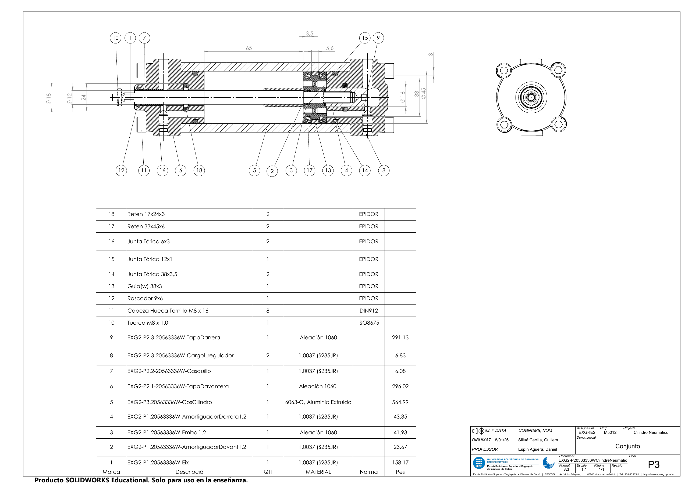
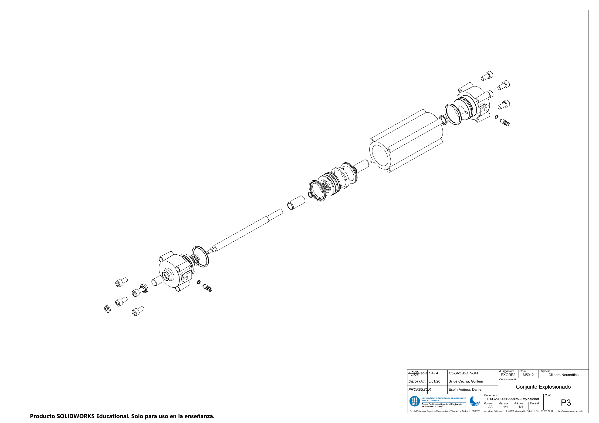

# Cilindro Neumático de Doble Efecto

Diseño completo **desde cero** de un cilindro neumático de doble efecto en **SolidWorks**. Incluye el modelado 3D de cada componente, el ensamblaje del conjunto y los planos técnicos acotados, con tolerancias, ajustes, acabados y especificaciones de fabricación, listos para producción.



---

## Características principales

- **Diámetro interior de la camisa:** Ø38 mm
- **Vástago:** Ø12 mm, con rosca para tuerca M8
- **Amortiguación regulable** en ambos extremos mediante tornillos reguladores
- **Estanqueidad completa:** retenes, juntas tóricas, guía y rascador (catálogo EPIDOR)
- **Unión de tapas y camisa** con 8 tornillos DIN 912 M8×16

## Componentes

| Nº | Pieza | Material |
|---|---|---|
| 1 | Vástago (Eix) | Acero S235JR (1.0037) |
| 2 | Amortiguador delantero | Acero S235JR |
| 3 | Émbolo | Aluminio 1060 |
| 4 | Amortiguador trasero | Acero S235JR |
| 5 | Camisa / cuerpo del cilindro | Aluminio extruido 6063-O |
| 6 | Tapa delantera | Aluminio 1060 |
| 7 | Casquillo | Acero S235JR |
| 8 | Tornillo regulador (×2) | Acero S235JR |
| 9 | Tapa trasera | Aluminio 1060 |
| 10–11 | Tuerca M8 (ISO 8675) y tornillos M8×16 (DIN 912) | Normalizado |
| 12–18 | Rascador, guía, juntas tóricas y retenes | EPIDOR |

## Vista explosionada



---

## Estructura del repositorio

```
Cilindro-Neumático/
├── Piezas/   # Piezas (.SLDPRT) y ensamblajes (.SLDASM)
│   ├── Assemblatge2.SLDASM               # Ensamblaje principal
│   └── AssemblatgeExplosionat.SLDASM     # Ensamblaje con vista explosionada
├── Plano/    # Planos en PDF (conjunto y explosionado)
└── img/      # Imágenes del README
```

## Cómo abrirlo

1. Clona el repositorio.
2. Abre `Piezas/Assemblatge2.SLDASM` y `Piezas/AssemblatgeExplosionat.SLDASM` con **SolidWorks 2025** o una versión posterior.

Todas las piezas están en la misma carpeta, así que las referencias se resuelven solas.

---

## Autor

**Guillem Sillué Cecilia** — [@guisice03](https://github.com/guisice03)

Proyecto realizado en la Escola Politècnica Superior d'Enginyeria de Vilanova i la Geltrú (EPSEVG – UPC).
